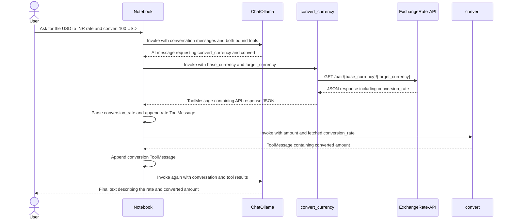

# Currency Conversion Notebook Flow

## Overview

The notebook uses a `ChatOllama` model with two LangChain tools:

1. `convert_currency` requests the exchange rate for a base and target currency from ExchangeRate-API.
2. `convert` multiplies an amount by a conversion rate.

The model proposes calls to both tools. The notebook executes those calls itself, replaces the rate argument for `convert` with the rate returned by the API, adds the resulting tool messages to the conversation, and asks the model to produce a final response.

## Sequence



## Components

- **API key setup:** The notebook reads `API` from the environment. The key is interpolated into the ExchangeRate-API URL.
- **`convert_currency(base_currency, target_currency)`:** Makes a GET request to the provider's pair-conversion endpoint and returns `response.json()`.
- **`convert(base_currency_value, conversion_rate)`:** Multiplies the amount by the rate and returns a float. `conversion_rate` is marked as an `InjectedToolArg`; the notebook fills it from the API result before invoking the tool.
- **Chat model:** `ChatOllama(model="qwen2.5:3b", temperature=0)` is bound to both tools. It proposes tool calls; the notebook's Python code, not the model, invokes them.
- **Tool dispatch:** The notebook loops over `ai_messages.tool_calls`, handles each call by name, appends the resulting `ToolMessage`, and invokes the model again with the accumulated messages.

## Tool Inputs and Results

### Exchange-rate tool

Input:

```json
{
  "base_currency": "USD",
  "target_currency": "INR"
}
```

The tool builds a request to:

```text
https://v6.exchangerate-api.com/v6/{API}/pair/USD/INR
```

It returns the provider's JSON response, which includes fields such as `result`, `base_code`, `target_code`, and `conversion_rate`.

### Conversion tool

Input when invoked by the notebook:

```json
{
  "base_currency_value": 100,
  "conversion_rate": 95.9069
}
```

The notebook uses the API result's `conversion_rate` as the value of `conversion_rate` and the tool returns the product, for example `9590.69`.

## Current Limitations

- The notebook does not validate currency codes or amounts.
- The HTTP request does not specify a timeout or call `raise_for_status()`. Network errors, HTTP errors, or an unsuccessful API JSON response are not handled explicitly.
- The notebook directly indexes `conversion_rate` in the API JSON. If the field is missing, the tool-dispatch cell fails.
- The model can request multiple tools or provide an incorrect rate for `convert`; the notebook overwrites that argument with the fetched rate when it processes the `convert_currency` call first.
- The dispatch logic assumes `convert_currency` is processed before `convert`. If calls arrive in the opposite order, `conversion_rate` may not yet be set.
- Conversation state is held in the mutable `messages` list. Rerunning cells that append messages can retain or add prior tool results, so restart the kernel or recreate `messages` to repeat the example with a clean conversation.
- The final response is generated by the model from the accumulated messages. The notebook does not independently verify the wording or formatting of that response.
